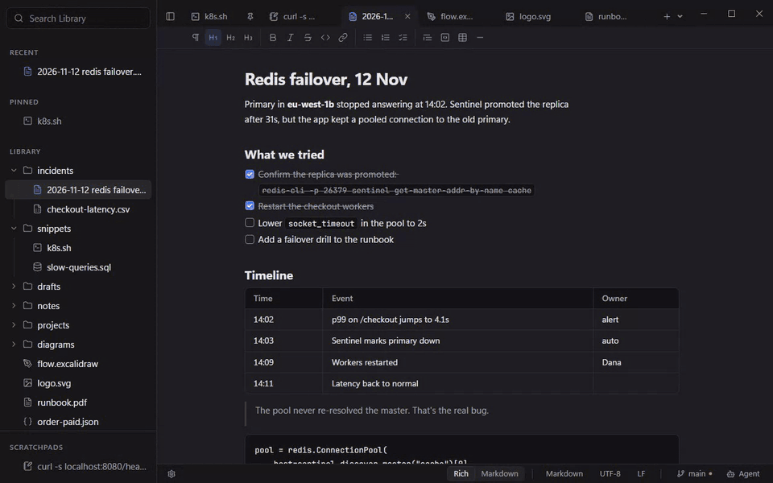

<div align="center">


# Zukai

**A fast, local notebook for engineers.**

Keep notes, commands, sketches and data side by side in one tabbed app.<br>
Everything stays as plain files on your own disk, with no account or cloud.

[](https://github.com/peota/zukai/releases/latest)
[](LICENSE)


<br>



</div>

---

You're mid-task with the IDE, terminal and browser open, and you need somewhere to put the query that worked or the curl command you'll want again next week. Press `Ctrl+N` (`Cmd+N` on macOS) and type. Zukai saves as you type and brings your tabs back when you return.

## Features

- **Scratchpads.** A new tab opens ready for typing, with nothing to name or save. Zukai restores your tabs after a restart.
- **Code editor.** Syntax highlighting with language detection, multiple cursors, regex find and replace, folding and JSON formatting. Zukai keeps each file's encoding and line endings.
- **Markdown.** Write in a Notion-like rich editor, or switch to plain Markdown with a live preview.
- **Canvas.** Draw diagrams on an Excalidraw canvas, saved as standard `.excalidraw` files.
- **CSV tables.** Open `.csv` and `.tsv` files as a grid. Sort by any column, filter rows, and edit cells, rows and columns in place, or switch to the raw text. Zukai detects the delimiter and header row, and saves edits back to the plain file.
- **Images and PDFs.** Open them in a tab beside your notes. You can search inside a PDF, and Zukai reopens it at the page you left.
- **Split view.** Put any two tabs side by side or top and bottom.
- **Library.** Your notebook is a folder of ordinary files. Browse it in the sidebar, jump to a file with quick open (`Ctrl+P`) and pin the ones you use most. Edits from other apps show up live.
- **Git sync.** Pull, commit and push your notebook folders without leaving the app.
- **Terminal and agents.** Open a terminal panel under your notes, or start Claude Code, Codex, Gemini CLI, OpenCode or Cursor from one menu.
- **Hidden text.** Mask a pasted password or token on screen without changing the file.
- **Keyboard-first.** Shortcuts cover tabs, splits, find, the sidebar and the terminal.
- **Themes and updates.** Choose from five light and dark themes and an accent color. Zukai tells you when a new version is out.

## Download

Get the latest version from the [releases page](https://github.com/peota/zukai/releases/latest).

| Platform                        | File                                                         |
| ------------------------------- | ------------------------------------------------------------ |
| Windows                         | `Zukai_x.y.z_x64-setup.exe`                                  |
| macOS (Apple Silicon and Intel) | `Zukai_x.y.z_universal.dmg`                                  |
| Debian / Ubuntu                 | `Zukai_x.y.z_amd64.deb`                                      |
| Arch Linux                      | `zukai-x.y.z-1-x86_64.pkg.tar.zst` (`sudo pacman -U <file>`) |
| Other Linux                     | `Zukai_x.y.z_amd64.AppImage`                                 |

The builds aren't code-signed yet. On Windows, click **More info → Run anyway** in SmartScreen. On macOS, right-click the app and choose **Open** the first time.

## Build from source

You need [Node.js](https://nodejs.org) 22, [pnpm](https://pnpm.io) and [Rust](https://rustup.rs), plus the [Tauri prerequisites](https://v2.tauri.app/start/prerequisites/) for your OS.

```sh
pnpm install
pnpm app          # run in development
pnpm tauri build  # build installers into src-tauri/target/release/bundle
```

Zukai uses [Tauri 2](https://tauri.app), React, [CodeMirror 6](https://codemirror.net), [Milkdown](https://milkdown.dev) and [Excalidraw](https://excalidraw.com).

## License

[MIT](LICENSE)
